<div align="center">


# Jim-Bro

**An AI fitness & nutrition coach you talk to like a trainer.**

Say what you ate or snap a photo, and it logs the meal, does the macro math and shows
where your day lands. It builds and adapts your diet and training plans, tracks your body,
and drives the app's screens for you.


[Features](#features) ·
[Screenshots](#screenshots) ·
[Quick start](#quick-start) ·
[Configuration](#configuration) ·
[Project structure](#project-structure) ·
[The agent](#the-agent) ·
[AI usage](#ai-usage-and-extensions) ·
[Docs](#docs) ·
[License](#license)

</div>

<p align="center">
  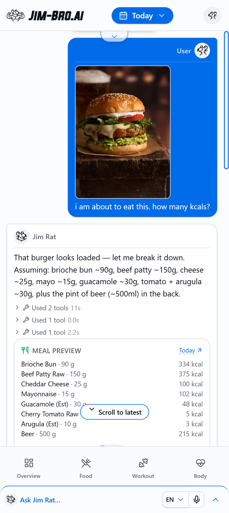
  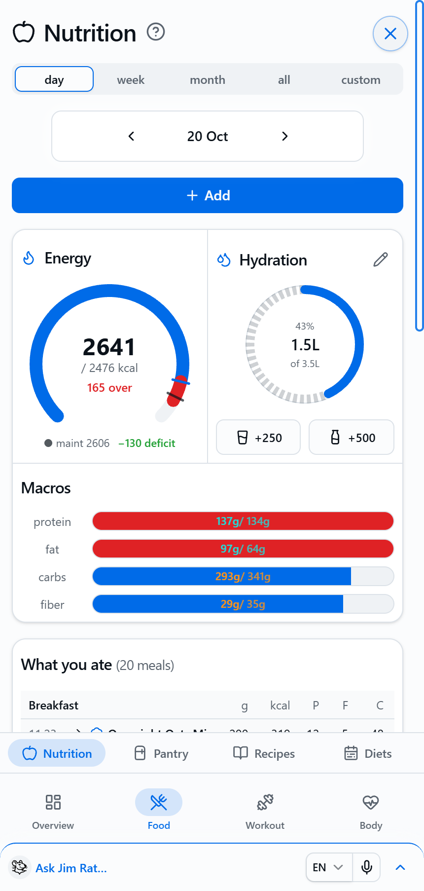
  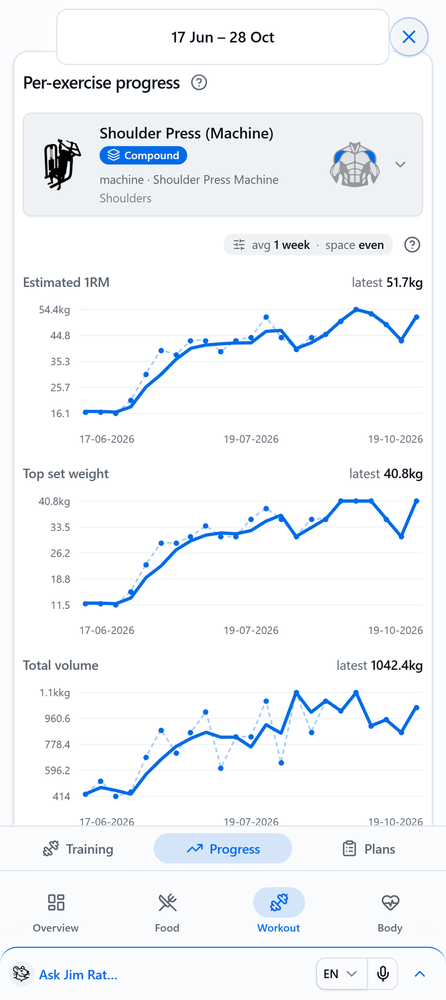
  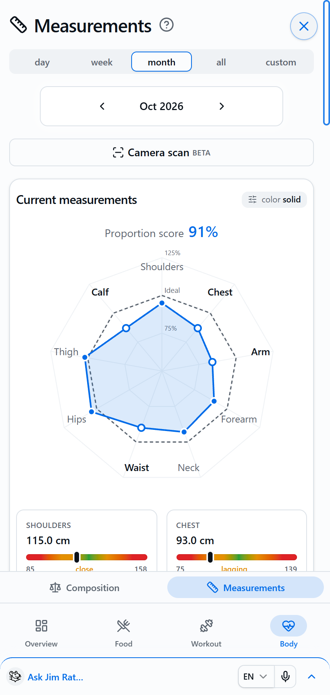
</p>

The chat isn't a help box bolted onto a tracker: **the chat is the app.** Changes open a
pre-filled form you confirm with one tap, questions come as buttons, and answers come as
cards (calorie ring, macro bars, trend charts) instead of walls of text.

---

## Features

| Area             | What you get                                                                                                                                         |
| ---------------- | ---------------------------------------------------------------------------------------------------------------------------------------------------- |
| **Food logging** | Log by sentence, plate photo, label or barcode. Preview the calorie ring before committing. Personal pantry, receipt/haul import, smart substitutes. |
| **Diet plans**   | Multi-day rotating plans with per-day macro targets, log-as-planned in one tap, shopping list from what the pantry is missing. Recipes from URLs.    |
| **Training**     | Workout splits, session logging (sets, reps, weight, RPE), progressive-overload nudges, 1RM trends, muscle maps, plan balance review, gym machines.  |
| **Body**         | Weigh-ins, body fat, BMI, FFMI, lean/fat mass, VO₂max, BMR/TDEE, tape measurements vs. ideal proportions, on-device body scan (beta).                |
| **Exports**      | Printable PDFs of diet plans, workout plans, recipes and a configurable progress report.                                                             |
| **Coach**        | Streaming chat with voice input, cited evidence answers, navigates the app for you, files your feature requests and bugs.                            |
| **Languages**    | English, Greek, Italian, Dutch, Albanian, Arabic, Persian, Urdu (right-to-left for the last three).                                                  |
| **Accounts**     | Email or Google sign-in, GDPR account deletion, a per-user AI usage and cost preview.                                                                |

---

## Screenshots

### Chat

Snap a photo, get a meal preview, confirm with a button; paste a recipe link and
it's imported and ready to edit.

|                                                 Photo → calories                                                  |                                                    Log it?                                                    |                                             Recipe import                                              |                                           Edit the recipe                                            |
| :---------------------------------------------------------------------------------------------------------------: | :-----------------------------------------------------------------------------------------------------------: | :----------------------------------------------------------------------------------------------------: | :--------------------------------------------------------------------------------------------------: |
|  | 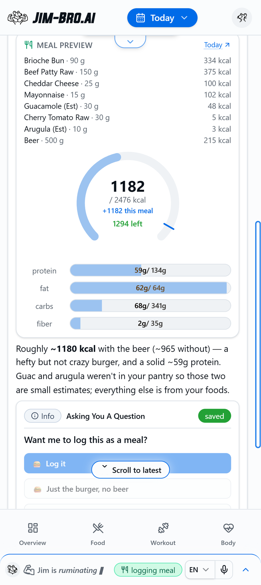 | 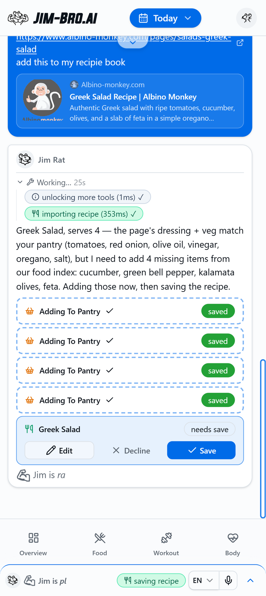 | 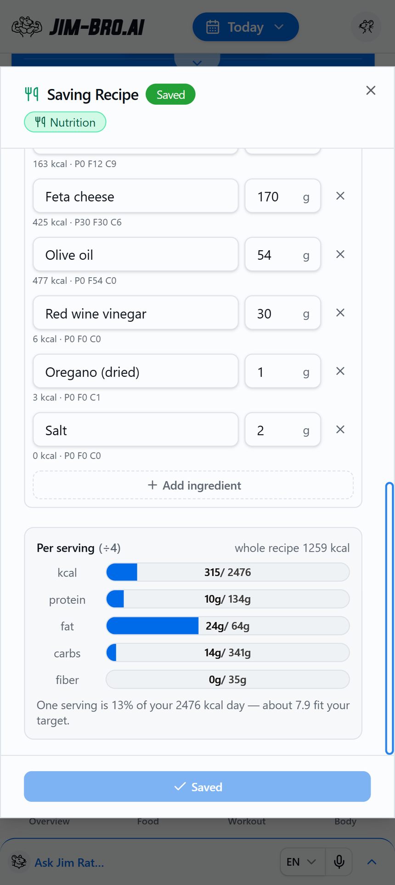 |

### Overview & food

|                                Overview                                 |                                    Nutrition (day)                                    |                                                Nutrition (period)                                                |                               Pantry                                |                                                               Edit pantry item                                                               |                                Recipes                                |
| :---------------------------------------------------------------------: | :-----------------------------------------------------------------------------------: | :--------------------------------------------------------------------------------------------------------------: | :-----------------------------------------------------------------: | :------------------------------------------------------------------------------------------------------------------------------------------: | :-------------------------------------------------------------------: |
| 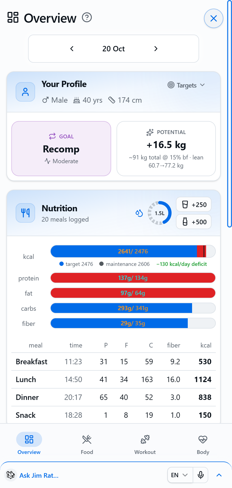 |  | 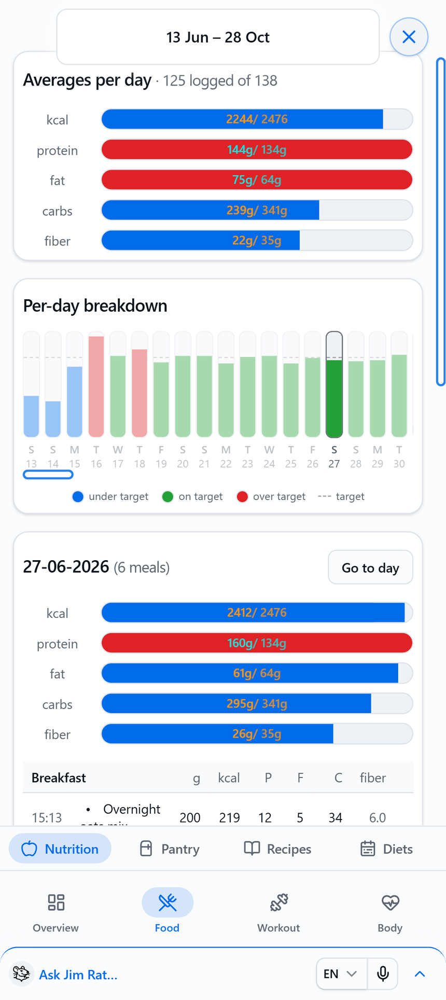 | 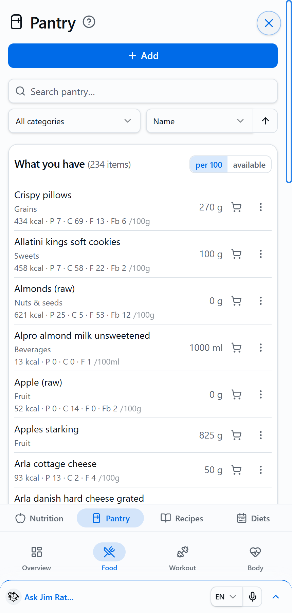 | 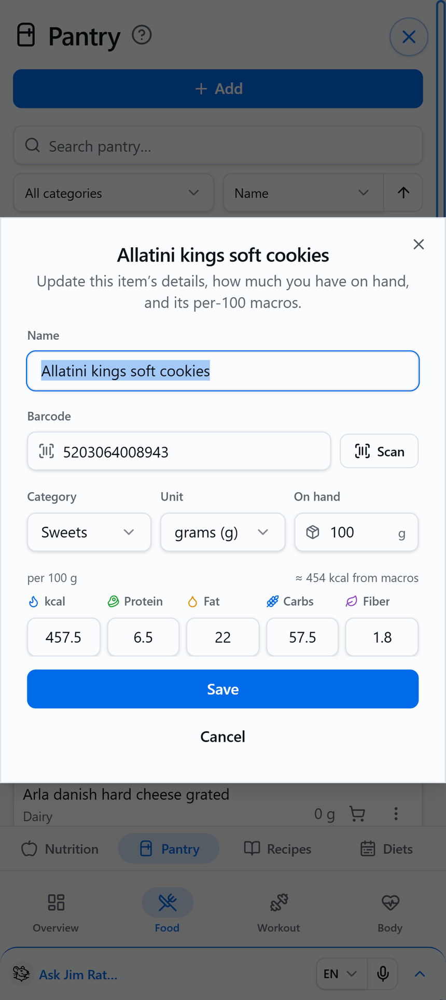 | 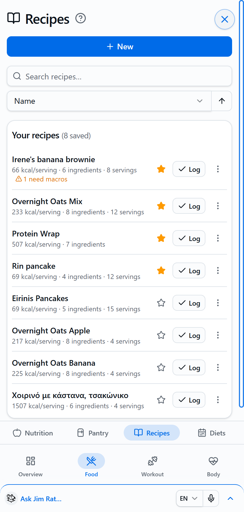 |

### Workout

|                                      Training                                       |                                            Exercise progress                                            |                                            Volume per muscle                                            |                                       Plans                                       |                                            Edit plan                                             |                                                   Weekly totals                                                    |
| :---------------------------------------------------------------------------------: | :-----------------------------------------------------------------------------------------------------: | :-----------------------------------------------------------------------------------------------------: | :-------------------------------------------------------------------------------: | :----------------------------------------------------------------------------------------------: | :----------------------------------------------------------------------------------------------------------------: |
| 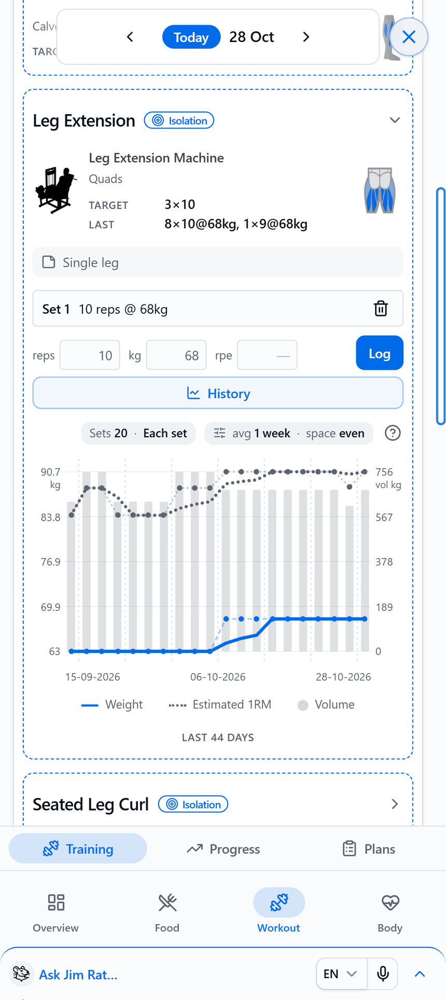 |  | 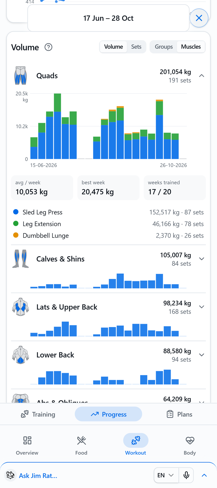 | 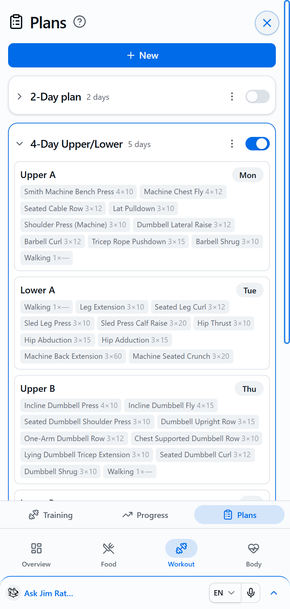 | 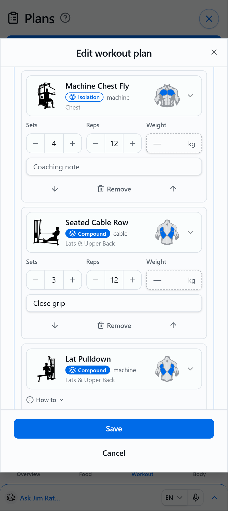 | 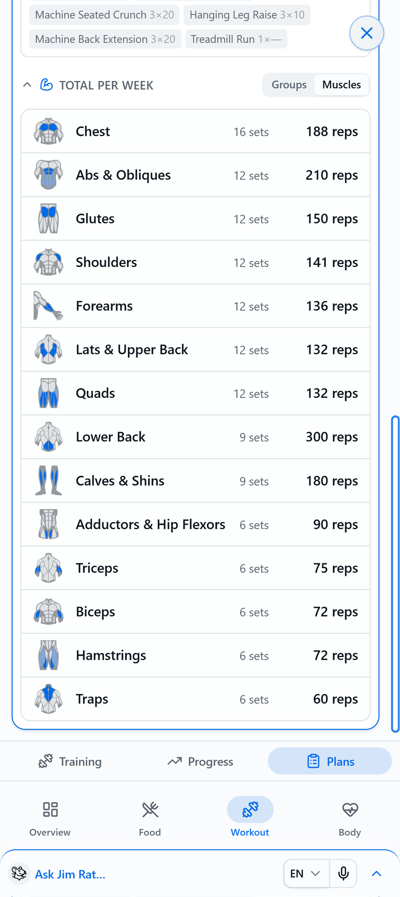 |

### Body

|                                           Composition                                           |                                           Composition charts                                            |                                                Measurements                                                |
| :---------------------------------------------------------------------------------------------: | :-----------------------------------------------------------------------------------------------------: | :--------------------------------------------------------------------------------------------------------: |
| 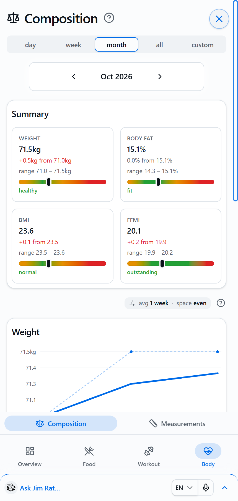 | 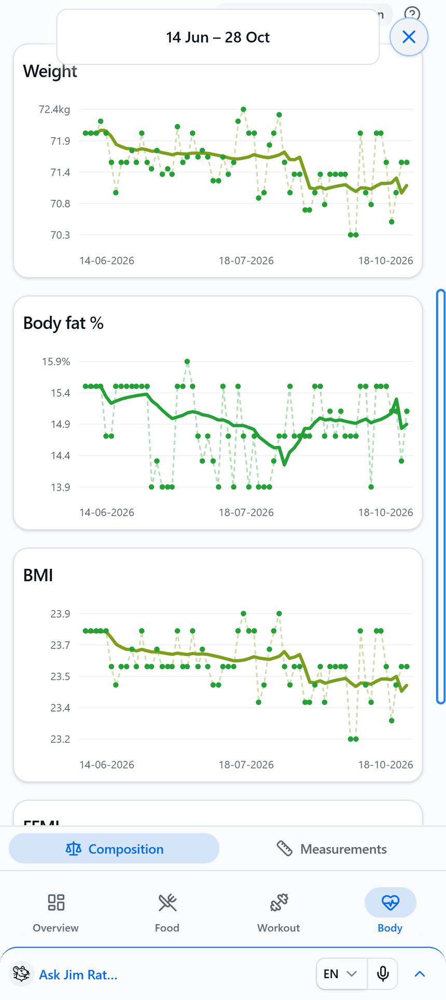 |  |

---

## Tech stack

- **Runtime:** Bun + TypeScript, npm workspaces monorepo
- **Web:** React, Vite, Tailwind, React Query (Orval-generated hooks), i18next, installable PWA
- **API:** `Bun.serve` HTTP + WebSocket, Zod schemas → OpenAPI 3.1
- **Data:** PostgreSQL via Drizzle, Meilisearch (food index, dev), Qdrant (evidence RAG), MinIO/S3
- **Auth:** Better Auth (email + Google), Resend for email
- **AI:** provider-agnostic agent: Anthropic, Kimi, OpenAI, Google, Mistral, DeepSeek, xAI, Qwen
- **Body scan:** MediaPipe (WebAssembly) pose + segmentation, in the browser
- **Deploy:** Docker (`Dockerfile`, `docker-compose.yml`)

---

## Quick start

**Prerequisites:** [Bun](https://bun.sh), Node/npm, PostgreSQL, and an API key for one LLM
provider. Step-by-step setup (database, auth secret, food index, Docker): [SETUP.md](SETUP.md).

```sh
npm install                 # repo root, installs every workspace
cp .env.example .env        # fill in the required variables below
npm run db:migrate          # apply the database migrations (SETUP.md §5)

npm run server:dev          # API on :3000, hot reload
npm run web:dev             # Vite on :5173, proxies the API
```

Open <http://localhost:5173>, sign up, and start chatting.

**Production** is one process: `npm run web:build`, then `npm run server:prod` serves the
built app and the API from :3000. The [Dockerfile](Dockerfile) builds the same thing as an image.

### Scripts

| Script                                     | What it does                                        |
| ------------------------------------------ | --------------------------------------------------- |
| `server:dev` / `server:prod`               | Run the API (with / without watch)                  |
| `web:dev` / `web:build`                    | Run or build the web app                            |
| `gen:api`                                  | Regenerate the OpenAPI spec, typed client and hooks |
| `db:migrate` / `db:generate` / `db:studio` | Apply / write migrations, browse the database       |
| `typecheck` / `lint` / `format`            | TypeScript, ESLint, Prettier across the repo        |

Tests use Bun's runner: `bun test` (pure logic in `packages/shared`, the agent loop, the server).

---

## Configuration

All settings are environment variables in `.env` at the repo root;
[.env.example](.env.example) documents each one.

| Required                                | Purpose                                                         |
| --------------------------------------- | --------------------------------------------------------------- |
| `DATABASE_URL`                          | Postgres connection string                                      |
| `BETTER_AUTH_SECRET`, `BETTER_AUTH_URL` | Session signing and the public app URL                          |
| `LLM_PROVIDER` + that provider's key    | e.g. `anthropic` + `ANTHROPIC_API_KEY`, `kimi` + `KIMI_API_KEY` |

| Optional          | Variables                                                                        |
| ----------------- | -------------------------------------------------------------------------------- |
| Models            | `LLM_MODEL`, `LLM_FAST_PROVIDER`, `LLM_FAST_MODEL`, `VISION_MODEL`               |
| Food data         | `MEILI_URL`, `MEILI_MASTER_KEY`, or `FOODREF_LIVE` + `FDC_API_KEY` for live APIs |
| Evidence (RAG)    | `QDRANT_*`, `EMBEDDER_*`, `RERANKER_*`, `S3_*`                                   |
| Email and sign-in | `RESEND_API_KEY`, `EMAIL_FROM`, `GOOGLE_CLIENT_ID`, `GOOGLE_CLIENT_SECRET`       |
| Extensions        | `SERVER_EXTENSIONS` (see [AI usage and extensions](#ai-usage-and-extensions))    |

---

## Project structure

```text
apps/
  server/          @fa/server   Bun.serve HTTP API + /ws chat socket, barcode + link
                                preview, server extension loader
  web/             @fa/web      React + Vite PWA (Chat, Dashboard, Nutrition, Workout,
                                Body, AI usage), i18n, PDF exports, on-device body scan
packages/
  agent/           @fa/agent    chat loop, tools, prompts, vision (food/receipt),
                                LLM providers, AI usage recorder
  shared/          @fa/shared   pure logic: BMR/TDEE, macros, substitutes, shopping,
                                strength, proportions, plan review, physique, model
                                prices, Zod schemas
  auth/            @fa/auth     Better Auth (email + Google), emails
  db_postgres/     @fa/db_postgres    Drizzle schema + client
  db_meilisearch/  @fa/db_meilisearch self-hosted OpenFoodFacts + USDA index (dev)
  db_qdrant/       @fa/db_qdrant      evidence knowledge base (PubMed ingest, RAG)
  storage/         @fa/storage        MinIO/S3 store for knowledge-base source files
  logger/          @fa/logger
drizzle/           migrations
```

### Why this shape

- **`shared` is pure.** No IO, no SDK. The same math runs in tools, API handlers, the web
  app and tests, so the coach and the screens never disagree on a number.
- **Everything is scoped by user.** The server takes the user from the Better Auth
  session, never from the request body.
- **Tools, not transcripts.** Each capability is a typed tool with a JSON schema. Writes
  go through a confirm gate (a pre-filled form in the chat); reads render cards. The
  web app can also run the same tools directly (`POST /tools/run`).
- **Provider seam.** `packages/agent/src/providers` normalizes streaming, tool calls,
  usage and web search per vendor. Product code never imports a vendor SDK.

---

## The agent

- **Provider and model:** `LLM_PROVIDER` / `LLM_MODEL` (default `anthropic` /
  `claude-sonnet-4-6`). Vision uses `VISION_MODEL`, or a
  vision-capable default when the chat model can't see images.
- **Tiered turns:** each turn is routed fast or deep. Fast turns run with thinking off,
  optionally on `LLM_FAST_PROVIDER` / `LLM_FAST_MODEL`; deep turns think.
- **State tag:** a `[State: …]` snapshot is prepended to each user message so the model
  skips orientation lookups.
- **Loop:** up to 10 tool-using steps, then one forced answer. Reads run in parallel,
  duplicate reads are blocked, web tools have per-turn caps, and web search only unlocks
  after a food-index miss.
- **Streaming:** chat streams over a resumable WebSocket (`/ws`); a dropped connection
  redials and picks the run back up. `POST /chat/stop` stops a run; the stopped turn still
  counts in AI usage for what it used.
- **History** is stored per user in Postgres and replayed on the next turn. Prompt
  caching is on where the provider supports it.
- **Food lookup:** pantry first, then the self-hosted OpenFoodFacts + USDA index
  (Meilisearch), then the web. `FOODREF_LIVE=true`
  switches to the live public APIs instead.
- **Evidence:** claims can be backed by the Qdrant knowledge base (PubMed and guidelines)
  and shown as a Sources card. Turn it off with `KNOWLEDGE_DISABLED=true`.

---

## Languages

The web app ships in English, Greek, Italian, Dutch, Albanian, Arabic, Persian and Urdu
(Arabic, Persian and Urdu render right-to-left). Strings live in
`apps/web/src/i18n/locales/<lang>/<feature>.json`. English is bundled, the rest load on
demand as one `locale-<lang>` chunk each, precached so switching works offline.
Exercise names come from a generated catalog (`scripts/exercise-catalog/gen-locale.ts`).
The web app sends a `[Locale: …]` tag so the agent replies in the UI language, while
anything it saves (recipe names, plan titles, notes) is written in the profile language.

---

## Exports

Printable PDFs, built in the browser from the same data as the screens
(`apps/web/src/export`):

- **Diet plan:** week strip, per-day macros against targets, meals.
- **Workout plan:** days and exercises, muscle volume per body part (cardio excluded).
- **Recipe:** ingredients, macros, instructions.
- **Progress report:** pick a period and sections (body composition, measurements,
  nutrition, training, cardio) in the profile's Export section.

---

## AI usage and extensions

Every feature is available to every user. The only gate is the server's AI setup: with no
LLM configured (no `LLM_PROVIDER` key), the coach chat and photo recognition show as
disabled with a "No AI model" badge, and everything else works as normal.

**AI usage** (user menu → AI usage) is a read-only preview of what the AI features cost to
run: raw provider tokens and an estimated cost at the provider's list price, per month,
per feature, per model and per day. Nothing is charged.

| What                                             | Where                                                                        |
| ------------------------------------------------ | ---------------------------------------------------------------------------- |
| Kinds, sources, model list prices                | [`packages/shared/src/usage.ts`](packages/shared/src/usage.ts)               |
| Recorder (`recordUsage`, `onUsage`) and report   | [`packages/agent/src/usage.ts`](packages/agent/src/usage.ts)                 |
| Chat turn recorded (one event per turn)          | `finally` block of `chatStream` in `packages/agent/src/agent.ts`             |
| Image calls recorded (food/receipt, chat photos) | `visionComplete({ bill })` in `packages/agent/src/vision.ts`                 |
| Feature flags + lock reasons                     | [`packages/shared/src/entitlements.ts`](packages/shared/src/entitlements.ts) |
| `GET /me/entitlements`, `GET /me/usage`          | `apps/server/src/routes/account.ts`                                          |
| Page                                             | [`apps/web/src/Usage.tsx`](apps/web/src/Usage.tsx)                           |

Table: `ai_usage_event`, one row per chat turn or image call. To price a new model, add a
row to `MODEL_PRICES` keyed `${provider}/${model}` exactly as the provider reports it; an
unpriced model still records its tokens, with no cost.

### Server extensions

Add-on packages (for example a hosted build with plans and payments) plug in without
editing core files. List them in `SERVER_EXTENSIONS` (comma-separated module specifiers)
or in `jimBro.serverExtensions` in the root `package.json`;
each default-exports a `ServerExtension` (see
[`apps/server/src/extensions.ts`](apps/server/src/extensions.ts)) and can:

- add HTTP routes (register their OpenAPI paths on the shared `registry` from an IO-free
  module listed in `jimBro.openapiExtensions`, so `npm run gen:api` picks them up),
- lock features per user (`entitlements`), with its own lock-reason codes,
- veto an AI call before it runs (`preflight`, e.g. a spending cap),
- subscribe to core hooks in `start`: `onUsage` from `@fa/agent` (every recorded AI
  call) and `onUserCreated` from `@fa/auth` (every signup).

---

## Adding a new capability

1. Put the math in `packages/shared/src/` (pure, with a test next to it).
2. Add the tool definition and handler in `packages/agent/src/tools.ts`, following the
   existing pattern (write tools go through the confirm gate).
3. Mention it in the tool selection guide in `packages/agent/src/prompts.ts` so the agent
   knows when to use it.
4. If it needs a card or form, add it in `apps/web/src/cards` or `apps/web/src/forms`,
   with strings in every locale.
5. If it adds an endpoint, run `npm run gen:api`.

---

## Docs

- [SETUP.md](SETUP.md): full local setup, endpoints, OpenAPI codegen, Docker
- [docs/db-schema.md](docs/db-schema.md): database tables
- [docs/search-and-knowledge-data.md](docs/search-and-knowledge-data.md): loading the food search index (Meilisearch) and the evidence knowledge base (Qdrant)
- [docs/vector-rag-implementation.md](docs/vector-rag-implementation.md): how evidence retrieval works and where it is headed

---

## License

Jim-Bro is **source-available** under the [PolyForm Noncommercial License 1.0.0](LICENSE).
You can use, study, modify and share it for free for any **noncommercial** purpose: personal
use, hobby projects, research, education, and charitable or public organizations.

**Commercial use is not allowed** without a separate license. That includes running it, modified
or not, for a business (for example a gym or personal-training service offering it to clients)
or as a paid product or service. For a commercial license, get in touch via
[jim-bro.kaldis.xyz](https://jim-bro.kaldis.xyz).

Contributions are welcome under the terms in [CONTRIBUTING.md](CONTRIBUTING.md).
